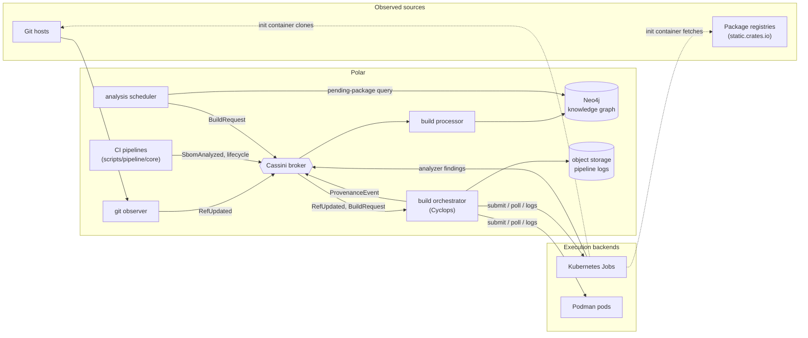
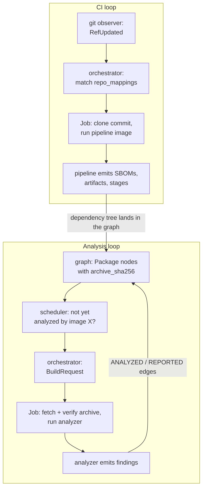
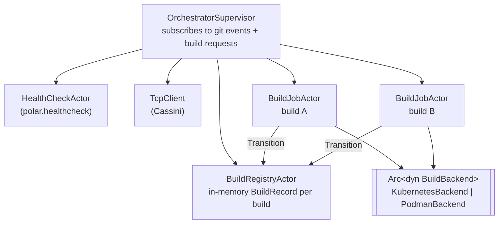
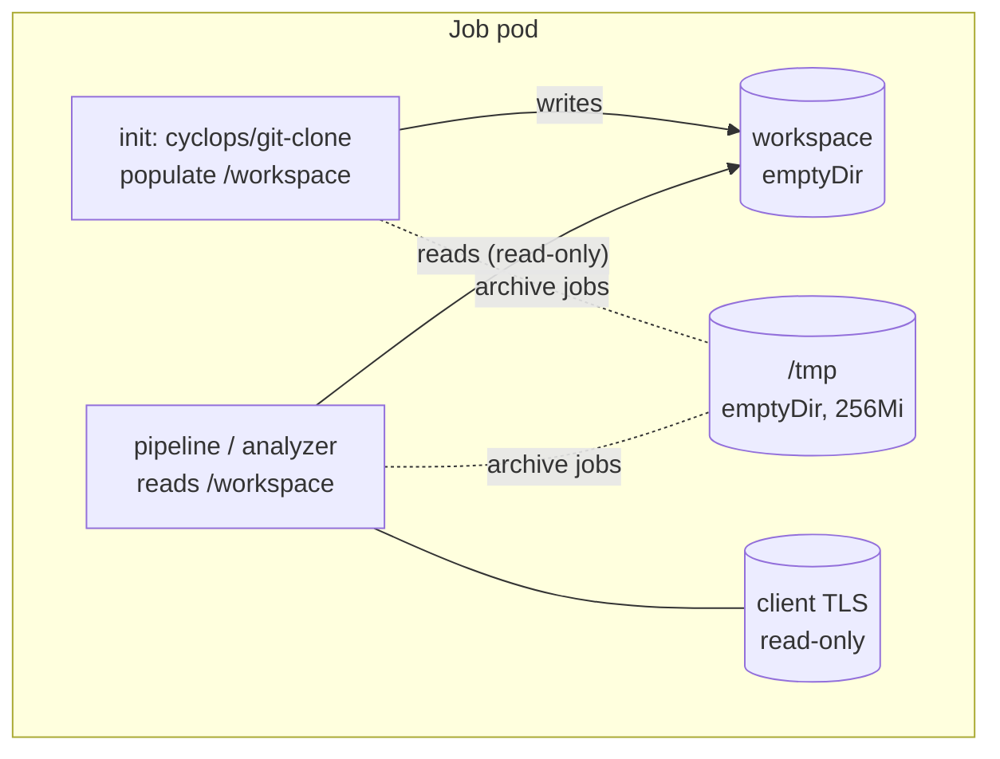
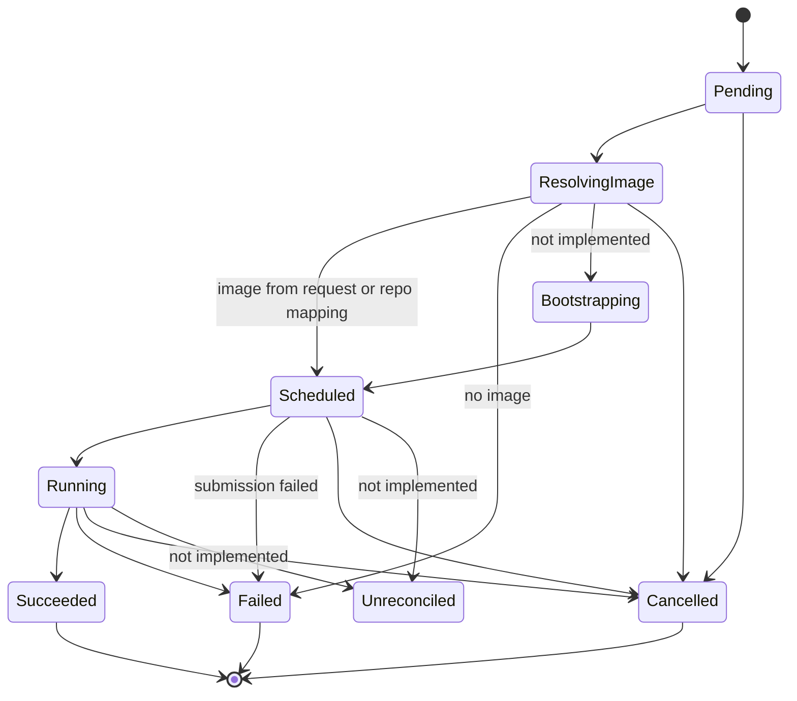
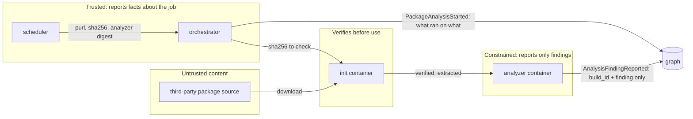

# Build Orchestrator (Cyclops): Architecture

**Status:** Implemented and tested at the unit and integration level; not yet deployed.
**Code:** [`src/agents/build-orchestrator/`](../../../src/agents/build-orchestrator/README.md), [`src/analyzers/`](../../../src/analyzers/)
**Companion documents:** [Flows and sequences](flows.md) · [Graph model](graph-model.md)

---

## 1. Purpose

Cyclops is Polar's **authoritative builder**. It runs a container image against
source that is pinned and verified, then records what happened in the knowledge
graph: which image ran, against which source, on which backend, and with what
outcome.

"Authoritative" is a deliberate split of responsibility. The orchestrator reports
the facts about the job. The job reports only what it alone knows: its findings,
or the stages and artifacts of a pipeline. A job can't misreport its own inputs,
because it never states them.

It serves two purposes with the same machinery:

1. **CI builds.** When a mapped git repository's ref moves, run that repository's
   pipeline image (e.g. `polar-ci` running `ci.nu`) at the new commit.
2. **Dependency source analysis.** For every package in the dependency graph
   Polar has ingested from SBOMs, run standardized, hardened analyzer images
   against the package's *published archive*: the bytes that actually get
   compiled into downstream artifacts.

Analysis runs aren't tracked in a separate datastore. The graph records which
analyzer image has analyzed which package, and the scheduler reads its work queue
back from that record.

## 2. System context

Cyclops and the scheduler never write to the graph directly. Everything goes
through Cassini to the build processor, the single writer for build and artifact
data. The scheduler only *reads* the graph.

## 3. The two loops

The loops feed each other. CI builds put dependency trees into the graph, and the
analysis loop then works through every package in them. It never analyzes the
same package with the same analyzer image twice, no matter how many projects
depend on it.

## 4. Components

### 4.1 Orchestrator actor tree

- **OrchestratorSupervisor** validates every request at the boundary, inserts it
  into the registry, and spawns one `BuildJobActor` per build. A Cassini
  transport error isn't fatal: running builds keep polling while the client
  reconnects.
- **BuildRegistryActor** is the only writer of build state, so concurrent builds
  need no locks. It rejects illegal state transitions.
- **BuildJobActor** owns one build: it resolves the image, submits, polls every
  5s, uploads logs and emits events. It stops itself at a terminal state.
- **The backend is chosen once at startup** from `backend.driver`. The actor tree
  never knows which concrete backend it's using.

### 4.2 Analysis scheduler

A single supervisor actor with a healthcheck and a Cassini client. Once
registered, it ticks every `ANALYSIS_INTERVAL_SECS`. On each tick it counts this
analyzer's in-flight runs, asks the graph for due packages up to the free slots,
and publishes one `BuildRequest` per package. Its only memory is a short dedup
window (see [flows §4](flows.md#4-scheduler-pass)).

### 4.3 Images

| Image | Built with | Contents | Runs as |
|---|---|---|---|
| `build-orchestrator` | nix-container-lib, Minimal | orchestrator binary + healthcheck | 1000 |
| `analysis-scheduler` | nix-container-lib, Minimal | scheduler binary + healthcheck | 1000 |
| `cyclops/git-clone` | nix-container-lib, Minimal | git, curl, tar, entrypoint script | 65532 |
| `polar-analyzer-cargo-manifest` | nix-container-lib, Minimal, Micro layer | nushell, pipeline library, analyzer, `cassini-client` | 65532 |
| `polar-ci` (not Cyclops-owned) | dockerTools | full Rust toolchain, Nix, cargo tools | root |

The analyzer image's **digest is the analyzer's identity in the graph**. Anything
that changes the digest without changing the analysis invalidates every past
result, so the image is kept minimal and its library prelude is pinned to a
specific revision. That's also why `polar-ci`, which tracks the latest nightly
toolchain, is unsuitable as an analyzer.

## 5. Job anatomy

Every job is the same two-container shape on both backends.

| | Git source | Archive source |
|---|---|---|
| Init env | `CYCLOPS_SOURCE_KIND=git`, `CYCLOPS_REPO_URL`, `CYCLOPS_COMMIT_SHA`, git credentials | `CYCLOPS_SOURCE_KIND=archive`, `CYCLOPS_ARCHIVE_URL`, `CYCLOPS_ARCHIVE_SHA256`, `CYCLOPS_SOURCE_PURL`; no credentials |
| Main env | `POLAR_BUILD_ID`, `CI_COMMIT_SHORT_SHA`, `job_env` | `POLAR_BUILD_ID`, `CYCLOPS_SOURCE_PURL`, `CYCLOPS_ARCHIVE_SHA256`, `job_env` |
| Security context | image defaults | non-root, read-only root, no privilege escalation, `drop: [ALL]`, `RuntimeDefault` seccomp |
| Command | `backend.command`, or the image entrypoint when empty | the analyzer image's entrypoint |
| Graph identity | `KubernetesJob {uid}` or `PodmanPod {pod_id, pipeline_container_id}` | same |

One exception to the table: on **Podman**, the init container runs as UID 0 inside
the pod. It has all capabilities dropped, a read-only root and no privilege
escalation, and under rootless Podman that UID maps to the unprivileged host
user. Moving it to 65532 needs testing to confirm it can still write to the pod's
workspace volume.

The two halves are bound by a shared contract: the env var names in
`orchestrator_core::types::source_env` and the `git-clone-entrypoint` script in
`package.nix`.

## 6. Build state machine

This state lives in memory in one orchestrator instance. The durable outcome is
what the build processor projects into the graph (see [graph model](graph-model.md)).

## 7. Trust boundaries

- **The content pin comes from the consumer's lockfile.** The archive sha256 is
  the `Cargo.lock` checksum, carried through the SBOM, not something the
  package's registry or author claims at analysis time. If a later SBOM claims a
  different digest for the same purl, the graph keeps the first one rather than
  overwriting it.
- **Findings can't be misattributed.** They carry only a `build_id`. The package
  link comes from the orchestrator's `PackageAnalysisStarted` for that build.
- **The analyzer never executes the package.** The first analyzer reads only the
  manifest and file layout. Analyzers that need to compile code (and therefore run
  its `build.rs`) belong in a separate, still more constrained tier.

## 8. Design decisions

| Decision | Reason |
|---|---|
| Analyze published archives, not declared git repos | The archive is what consumers compile. A package's declared `repository` is unverified, and the xz-utils backdoor existed only in the release tarball. Comparing an archive with its tag is a later analyzer, not an assumption. |
| The graph holds analysis history | No second store to keep consistent. "What has been analyzed by what" is the same data researchers query. Restarting the scheduler loses nothing important. |
| Analyzer identity = image digest | A tag can move. Rerunning everything after an analyzer change is automatic: a new digest means nothing has been analyzed by it yet. |
| Orchestrator reports run facts, analyzers report findings | This is the enforcement-kernel split: the component with authority over the execution states its inputs. |
| Archive jobs are hardened, git CI jobs are not | `polar-ci` runs as root with Nix. Polar's own pipeline is trusted code; third-party packages are not. |
| One backend per process | Kubernetes for clusters; Podman for single-host or air-gapped enclaves with no API server dependency. |

## 9. Known gaps

- **Job state is in memory.** A job that dies without a terminal event looks in
  flight forever and is never re-requested. The `Unreconciled` state exists to
  solve this but isn't implemented.
- **Network egress isn't restricted.** That needs a NetworkPolicy allowing only the
  broker (analyzer) and the archive host (init container).
- **Git credentials are placeholders** pending the credentials design.
- **Bootstrapping missing pipeline images** isn't implemented.
- **There are no deployment values** for these components in `infra/` yet.
