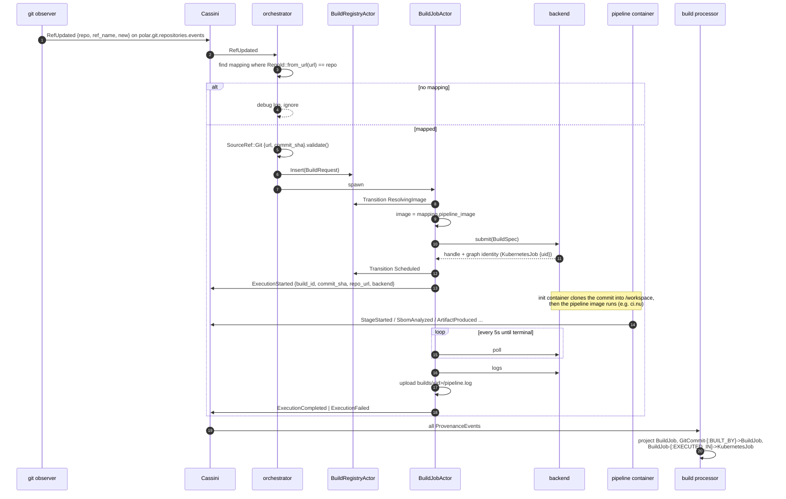
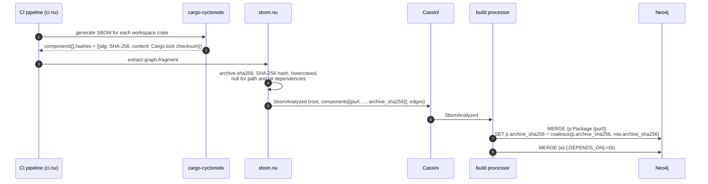
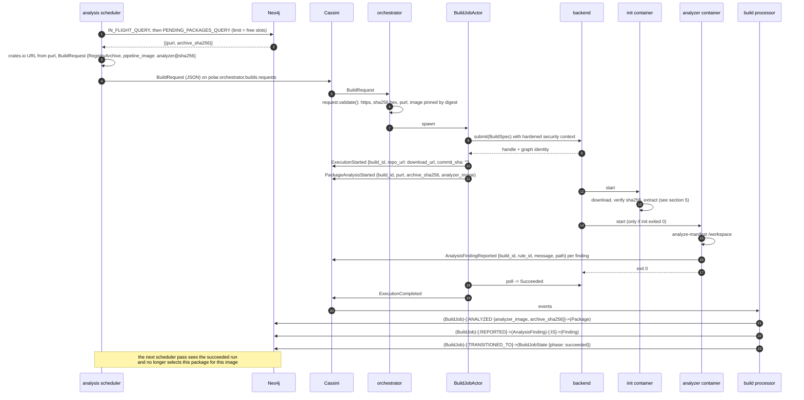
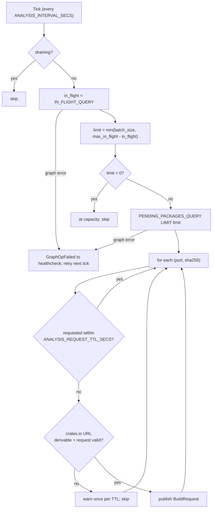
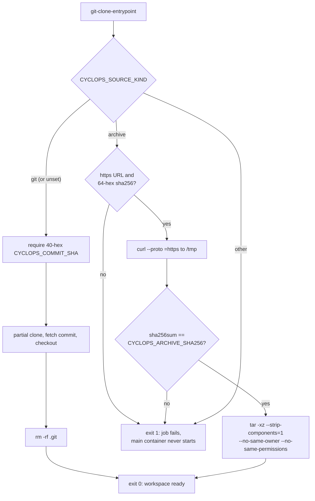
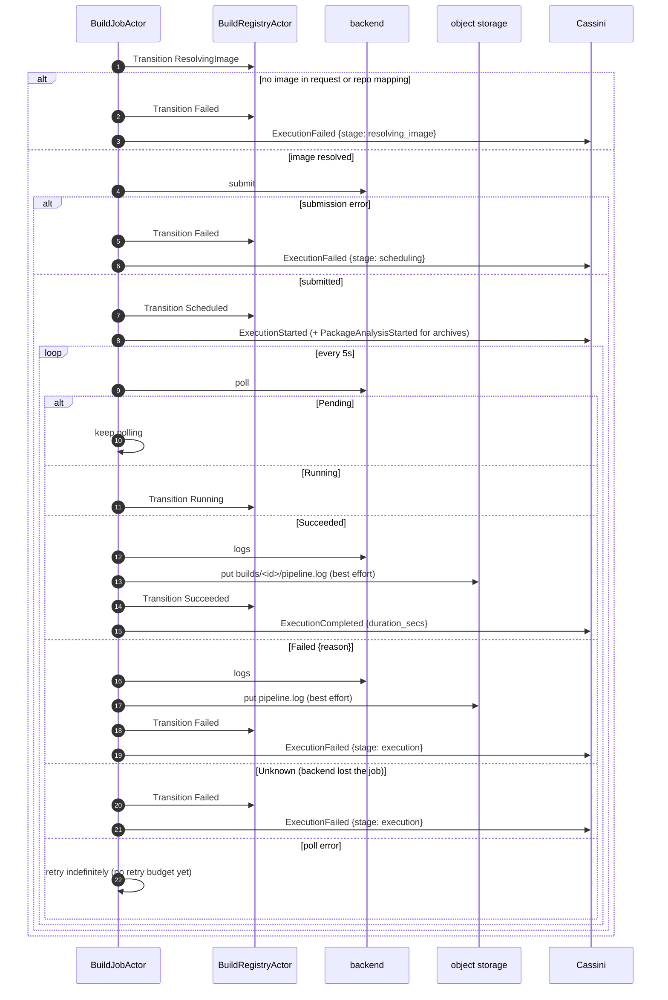
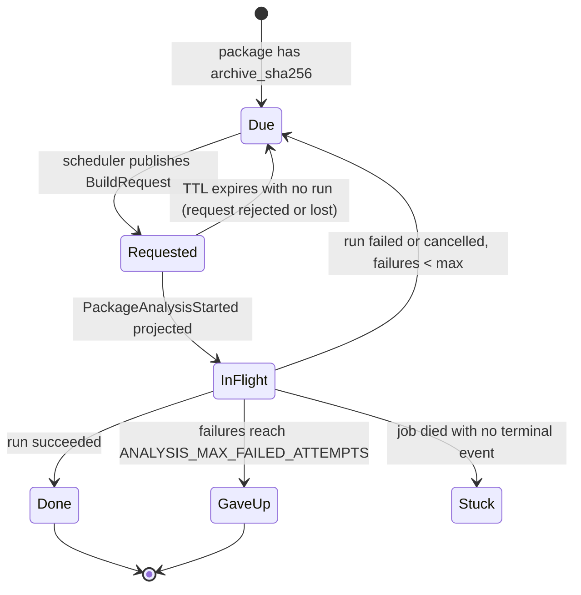
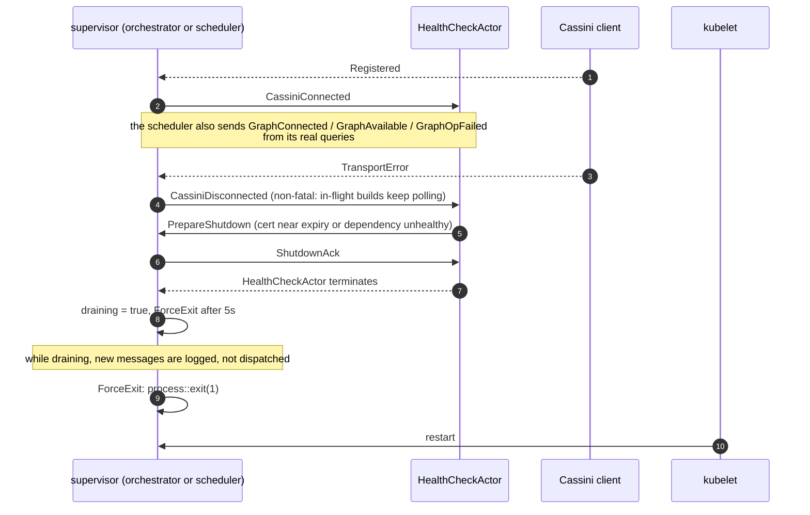

# Build Orchestrator (Cyclops): Flows and Sequences

Companion to [architecture.md](architecture.md). Each section is one flow. The
diagrams use the real topic, event and env var names from the code.

| Topic | Carries |
|---|---|
| `polar.git.repositories.events` | `GitRepositoryMessage` (rkyv), from the git observer |
| `polar.orchestrator.builds.requests` | `BuildRequest` (JSON), to the orchestrator |
| `polar.provenance.events` | `ProvenanceEvent` (rkyv from Rust agents, JSON from nushell), to the build processor |

---

## 1. CI build (git-triggered)

A ref moves on a repository listed in `repo_mappings`. The observer identifies
repos by `RepoId`, which can't be turned back into a URL. The mapping supplies the
clone URL, and also acts as the filter: unmapped repos aren't built.

## 2. Dependency ingestion: where `archive_sha256` comes from

The analysis loop can only start from packages whose published archive has a
verified content identity. That identity comes from the *consumer's* lockfile,
through the SBOM.

`coalesce` makes the digest first-writer-wins. A published archive is immutable,
so a later SBOM claiming a different digest for the same purl doesn't replace the
one analyses were pinned to.

## 3. Analysis run, end to end

The empty `commit_sha` is deliberate: an archive has no commit. The build
processor skips the `GitCommit-[:BUILT_BY]` edge when it's empty, so analysis runs
don't all collapse onto one empty-oid commit node.

## 4. Scheduler pass

A package is **due** for analyzer image `X` when all of these hold:

- its purl starts with `pkg:cargo/` and has no `?` qualifiers. Path and git
  dependencies have qualifiers, and `source` can't tell them apart: it reports
  `registry` for path crates.
- it has an `archive_sha256`.
- no run with `X` has succeeded or is still in flight.
- fewer than `ANALYSIS_MAX_FAILED_ATTEMPTS` runs with `X` have failed.

The dedup window covers the seconds between publishing a request and the
orchestrator's `PackageAnalysisStarted` reaching the graph. Losing it on restart
risks at most one duplicate request per package.

## 5. Source fetch and verification (init container)

Nothing from an unverified archive ever reaches `/workspace`. Stripping one
leading directory fits the crates.io, npm and PyPI source-archive layout, so
`/workspace` is the package root. Zip archives such as wheels aren't supported.

## 6. Job lifecycle and polling

A failure to upload logs never changes a build's outcome. `BuildJobMessage::Cancel`
exists, along with its `ExecutionCancelled` event, but nothing sends it yet.

## 7. Retry and eligibility, per (package, analyzer image)

How the graph state of a package's runs with one image decides whether the
scheduler requests it again:

`Stuck` is a known gap. A run with no `completed_at` counts as in flight forever,
until the orchestrator gets reconciliation (`Unreconciled`). A new analyzer image
digest puts every package back into `Due` for that image.

## 8. Health, rejuvenation and drain

Both the orchestrator and the scheduler follow the standard Polar healthcheck
pattern.

Restarting the orchestrator loses its in-memory record of running jobs. The jobs
themselves keep running on the backend and still emit their own events, but
their terminal lifecycle event is never sent: this is the `Stuck` case above.
