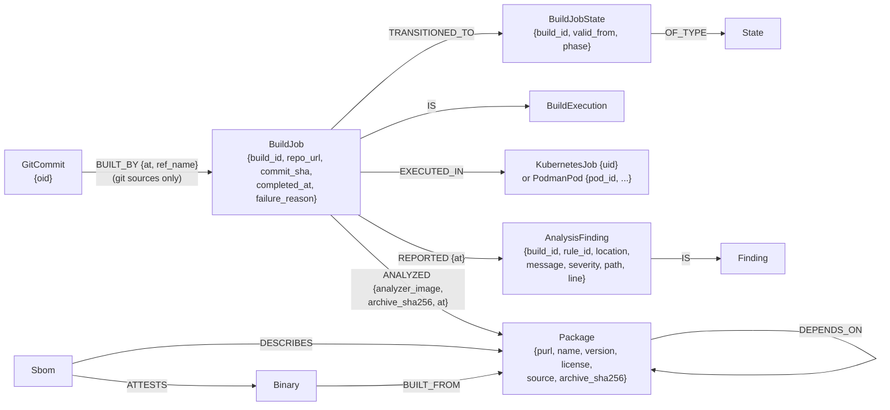

# Build Orchestrator (Cyclops): Graph Model

Companion to [architecture.md](architecture.md). This covers the part of the
knowledge graph that Cyclops's events produce and that the analysis scheduler
reads. Every node and edge here is written by the **build processor**. Cyclops and
the scheduler never write to the graph.

## 1. Shape



An **analysis run is a `BuildJob`** like any CI build. It has the same lifecycle
projection, backend linkage and state history. Analysis only adds `ANALYZED` and
`REPORTED`.

## 2. Who writes what

| Element | Written on | Origin | Notes |
|---|---|---|---|
| `BuildJob`, `EXECUTED_IN`, `IS` | `ExecutionStarted` | orchestrator | For archive builds `commit_sha` is empty and `repo_url` is the download URL |
| `GitCommit-[:BUILT_BY]->BuildJob` | `ExecutionStarted` | orchestrator | Skipped when `commit_sha` is empty |
| `BuildJob.completed_at` | Completed, Failed, Cancelled | orchestrator | Set on **every** terminal outcome, so it means "finished", not "succeeded" |
| `BuildJob.failure_reason`, `failure_stage` | `ExecutionFailed` | orchestrator | `resolving_image`, `scheduling` or `execution` |
| `BuildJobState {phase}` | each lifecycle event | orchestrator | Append-only. Current state is the instance with the latest `valid_from`; `succeeded` marks success |
| `Package.archive_sha256` | `SbomAnalyzed` | CI pipeline (`sbom.nu`) | First writer wins (`coalesce`). Null for path and git dependencies |
| `BuildJob-[:ANALYZED]->Package` | `PackageAnalysisStarted` | orchestrator | MERGE on the pair, so a replay doesn't add edges |
| `AnalysisFinding`, `REPORTED`, `IS` | `AnalysisFindingReported` | analyzer | Keyed by `(build_id, rule_id, location)`, so a replay is idempotent |

`location` is `path:line`, `path`, or the empty string, depending on what the
analyzer reported.

## 3. Scheduler queries

These are verbatim from `analysis-scheduler` (`scheduler/src/lib.rs`), tested
against Neo4j 5.26.2 in `scheduler/tests/pending_query.rs`.

**Packages due for analysis by `$analyzer_image`:**

```cypher
MATCH (p:Package)
WHERE p.purl STARTS WITH 'pkg:cargo/'
  AND NOT p.purl CONTAINS '?'
  AND p.archive_sha256 IS NOT NULL
  AND NOT EXISTS {
    MATCH (p)<-[a:ANALYZED]-(j:BuildJob)
    WHERE a.analyzer_image = $analyzer_image
      AND (j.completed_at IS NULL
           OR EXISTS { (j)-[:TRANSITIONED_TO]->(:BuildJobState { phase: 'succeeded' }) })
  }
  AND COUNT {
    MATCH (p)<-[a:ANALYZED]-(f:BuildJob)
    WHERE a.analyzer_image = $analyzer_image AND f.failure_reason IS NOT NULL
  } < $max_failed_attempts
RETURN p.purl AS purl, p.archive_sha256 AS sha256
ORDER BY p.purl
LIMIT $limit
```

**Runs of `$analyzer_image` currently in flight:**

```cypher
MATCH (j:BuildJob)-[a:ANALYZED]->(:Package)
WHERE a.analyzer_image = $analyzer_image AND j.completed_at IS NULL
RETURN count(DISTINCT j) AS n
```

## 4. Example research queries

These illustrate what the model is for. They aren't run by any component.

**Which binaries compile in a dependency whose build script runs at build time?**

```cypher
MATCH (b:Binary)-[:BUILT_FROM]->(:Package)-[:DEPENDS_ON*1..]->(dep:Package)
MATCH (dep)<-[:ANALYZED]-(:BuildJob)-[:REPORTED]->(f:AnalysisFinding { rule_id: 'build-script' })
RETURN b.content_hash AS binary, collect(DISTINCT dep.purl) AS build_script_deps
```

**Coverage of an analyzer across the ingested dependency graph:**

```cypher
MATCH (p:Package) WHERE p.archive_sha256 IS NOT NULL
OPTIONAL MATCH (p)<-[a:ANALYZED { analyzer_image: $img }]-(j:BuildJob)
WHERE EXISTS { (j)-[:TRANSITIONED_TO]->(:BuildJobState { phase: 'succeeded' }) }
RETURN count(DISTINCT p) AS packages, count(DISTINCT CASE WHEN j IS NOT NULL THEN p END) AS analyzed
```

**What did a new analyzer version find that the previous one didn't?**

```cypher
MATCH (p:Package)<-[:ANALYZED { analyzer_image: $new }]-(:BuildJob)-[:REPORTED]->(f:AnalysisFinding)
WHERE NOT EXISTS {
  MATCH (p)<-[:ANALYZED { analyzer_image: $old }]-(:BuildJob)-[:REPORTED]->(g:AnalysisFinding)
  WHERE g.rule_id = f.rule_id AND g.location = f.location
}
RETURN p.purl, f.rule_id, f.location, f.message
```

## 5. Invariants

- **Every `AnalysisFinding` belongs to exactly one `BuildJob`.** The package it
  concerns is reached only through that job's `ANALYZED` edge.
- **An analyzer image is identified by digest**, so results from different
  analyzer versions never mix.
- **A package's `archive_sha256` never changes after it's first set.** A
  conflicting SBOM claim is ignored, not applied. Surfacing such conflicts would
  be a useful future analysis.
- **`completed_at IS NOT NULL` does not mean success.** Use the `succeeded` state
  instance.
