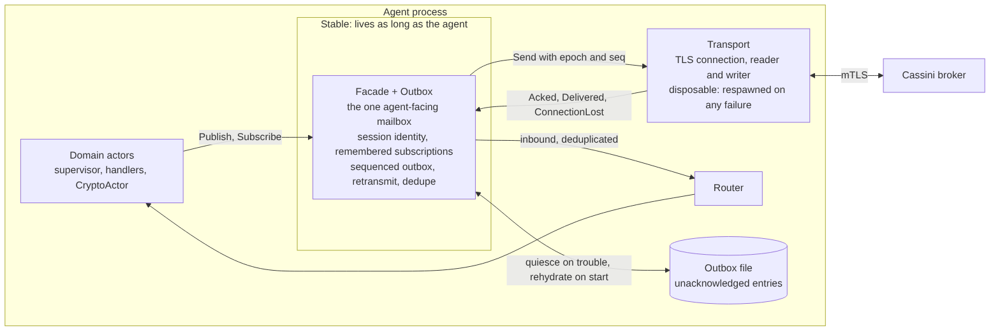
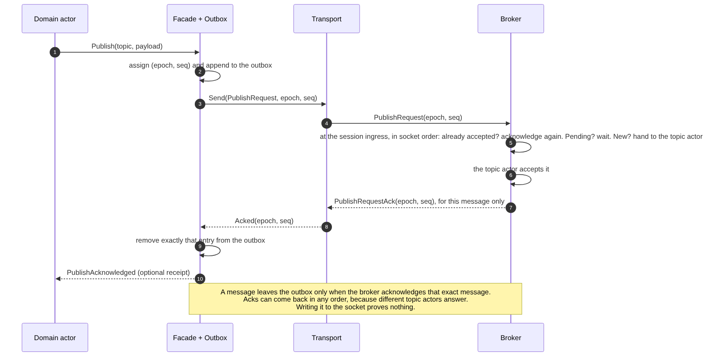
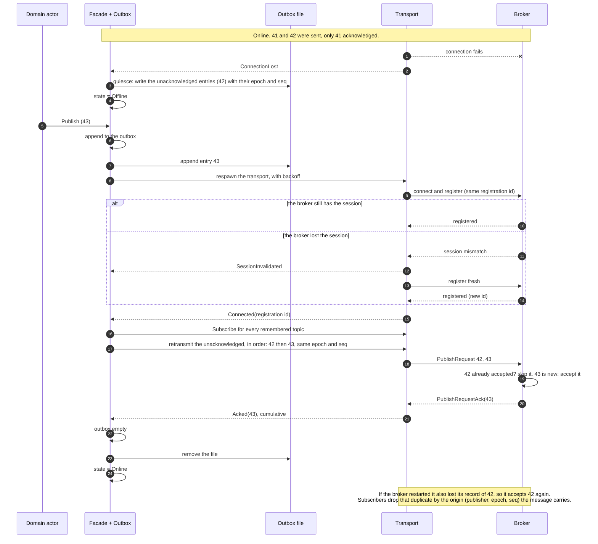
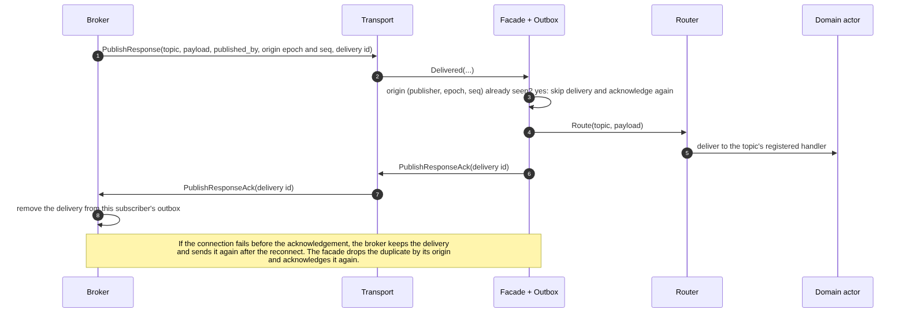
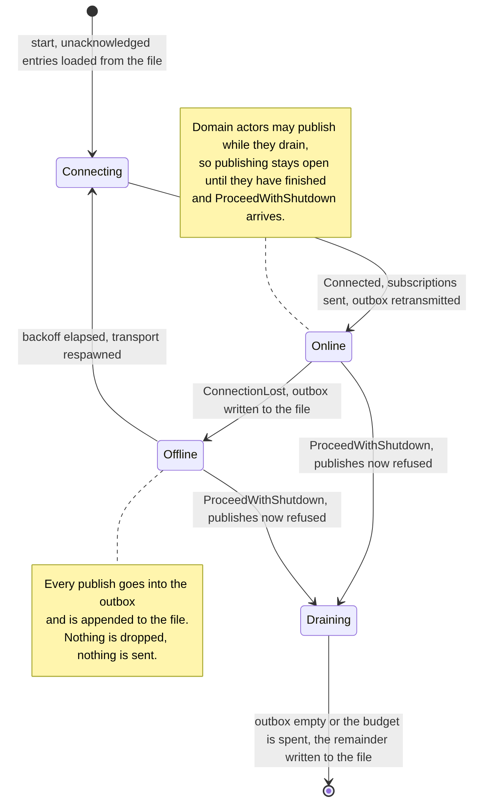

<!--
  ACE Tool

  Copyright 2026 Carnegie Mellon University.

  NO WARRANTY. THIS CARNEGIE MELLON UNIVERSITY AND SOFTWARE ENGINEERING INSTITUTE MATERIAL IS
  FURNISHED ON AN "AS-IS" BASIS. CARNEGIE MELLON UNIVERSITY MAKES NO WARRANTIES OF ANY KIND, EITHER
  EXPRESSED OR IMPLIED, AS TO ANY MATTER INCLUDING, BUT NOT LIMITED TO, WARRANTY OF FITNESS FOR
  PURPOSE OR MERCHANTABILITY, EXCLUSIVITY, OR RESULTS OBTAINED FROM USE OF THE MATERIAL. CARNEGIE
  MELLON UNIVERSITY DOES NOT MAKE ANY WARRANTY OF ANY KIND WITH RESPECT TO FREEDOM FROM PATENT,
  TRADEMARK, OR COPYRIGHT INFRINGEMENT.

  Licensed under a MIT (SEI)-style license, please see license.txt or contact permission@sei.cmu.edu
  for full terms.

  [DISTRIBUTION STATEMENT A] This material has been approved for public release and unlimited
  distribution.  Please see Copyright notice for non-US Government use and distribution.

  This Software includes and/or makes use of Third-Party Software each subject to its own license.

  DM26-0670
-->

# Cassini client reliability

Status: **design; build step 1 is done** (the facade, the in-memory offline buffer and the removal of the
supervisor's respawn, 2026-10-08), the rest is not. Written 2026-10-08 from a design discussion. It describes what the
Cassini client does today, why that loses messages, and the structure that replaces it. The open
decisions are in section 6.

## 1. What happens today

An agent publishes through `TcpClient` (`lib/src/cassini.rs`), a thin wrapper over the
`TcpClientActor` mailbox (`cassini/client/src/lib.rs`). One actor is both the API and the
connection.

- **`publish` is a cast to the actor's mailbox.** It succeeds whenever the mailbox is open, whether or
  not the broker is reachable. Only a closed mailbox (the actor is dead) reaches the offline policy.
- **The offline policy** (`OfflineBehavior`): `Fail` returns `BrokerUnavailable`; `Drop` returns Ok
  and discards; `Queue`, the default at almost every call site, appends a JSON line (`QueueEntry`:
  topic, base64 payload, timestamp, `attempts: 0`) to the file at `CASSINI_QUEUE_PATH`, or returns
  `BrokerUnavailable` if that is unset. No deployment sets it, so for agents `Queue` is dead.
- **Nothing replays the queue for agents.** `MessageQueue::drain()` has no caller on the agent path;
  only the CLI daemon (`cli.rs`) has its own append-and-replay.
- **While registered**, a write failure stops the actor (`emit_transport_err_and_stop`): the message
  that failed to write is lost, and so is everything in the mailbox.
- **While unregistered** (starting, or after a disconnect), `handle_unregistered_fallback` logs a
  warning and drops the message.
- **At the broker**, the topic actor queues messages in memory when a topic has no subscribers, and
  sessions are in memory, so a broker restart loses both.
- **The acknowledgement** is `PublishRequestAck { topic, trace_ctx }`, sent when the topic actor has
  accepted the publish (not when subscribers have received it). The client surfaces it as
  `ClientEvent::PublishAcknowledged { topic }` and correlates it with nothing, because it carries no
  message identity.

The system is effectively at-most-once, with silent loss in at least four places. The dead `Queue`
path and the missing replay are bugs in their own right.

## 2. The structure

Split what `TcpClientActor` does into a stable part and a disposable part.

- **Facade + Outbox** is what the rest of the agent holds, and it lives as long as the agent. It owns
  the agent-facing mailbox, the session identity (registration id), the remembered subscriptions and
  the outbox: a queue of messages not yet acknowledged by the broker, each with an `(epoch, seq)`. It
  supervises the transport, so respawning it is internal: the infrastructure supervisor's respawn
  logic, the `InfrastructureRespawned` handler in each domain supervisor, and the crypto actor's
  `ClientReplaced` message all go away. It begins as one actor with the outbox as a module, and splits
  only if it grows.
- **Transport** is the TLS connection with its reader and writer. It is disposable: any failure ends
  it and the facade respawns it, with backoff (which is also the respawn-storm guard).
- **Outbox file** holds the unacknowledged entries while things are not well.

## 3. Message flows

### Publishing, online

A message gets its `(epoch, seq)` when it enters the outbox and leaves it only when the broker
acknowledges that exact message. Acks are per message and may arrive in any order: the broker's
session hands messages to different topic actors, which accept and answer independently, so a later
message can be acknowledged before an earlier one. A cumulative ack ("everything up to n") would
release an earlier message that was never accepted, which is data loss, so there is none. Writing to
the socket proves nothing about the broker.

### Losing the connection, and coming back

At the first sign of trouble the facade writes the unacknowledged entries to the file and goes
Offline. While offline every publish goes into the outbox and is appended to the file. When a
connection is back it registers (resuming the session, or fresh if the broker lost it), re-sends the
remembered subscriptions, retransmits the outbox in order with the same epoch and seq, and removes
the file once the outbox is empty.

### Deliveries from the broker

The same problem in the other direction. The broker keeps a delivery until the client acknowledges it
(`PublishResponseAck`, which exists in the protocol), and the facade drops a repeat by its origin.

### The facade's states

`Draining` starts at `ProceedWithShutdown`, not at `PrepareShutdown`: domain actors legitimately
publish while they drain, so publishing stays open until they have finished. From then on new
publishes are refused with an error, and the facade retransmits until the outbox is empty or what is
left of the shutdown budget is spent, then writes any remainder to the file. The budget therefore has
to include this time.

## 4. Duplicates

A retransmit after a lost acknowledgement delivers a message twice, so delivery is at-least-once
unless something removes the duplicates. The technique that needs no stored set of ids is a per-sender
sequence inside an epoch (the idea behind Kafka's idempotent producer and MQTT's QoS 2):

- The facade picks a random **epoch** each time it starts and numbers messages 1, 2, 3 within it.
- A receiver keeps, per sender and epoch, a contiguous watermark (everything at or below it is
  accepted) and a small set of accepted sequences above it, and drops anything it has already
  accepted. The set collapses into the watermark as gaps fill, and is bounded by the sender's outbox.
  It is discarded when the sender's session ends. A bare highest-sequence-seen is not enough: it
  would discard a late earlier message as a duplicate.
- Retransmission sends the unacknowledged in order, before anything newer. Within one connection the
  order is kept by the stream; across a reconnect it is kept by fencing the old connection. Receivers
  must still not assume that acks, or acceptance by different topic actors, follow that order.
- Entries carry the epoch they were numbered in, also across a restart: an entry loaded from the
  file keeps its original epoch and seq, and only new messages use the new epoch.

If the origin `(publisher identity, epoch, seq)` travels with the message to the subscriber, the same
rule removes duplicates at every hop, including after a broker restart that lost its own record. No
hash and no clock is needed for deduplication. Replay protection against an attacker is a different
matter, handled by mTLS and, for configuration, by signed monotonic versions.

## 5. Protocol and broker changes

- `PublishRequest` gains `epoch` and `seq`; `PublishRequestAck` returns them (cumulative).
- Deliveries (`PublishResponse`) carry the origin `(published_by, epoch, seq)` and a delivery id;
  `PublishResponseAck` returns the delivery id.
- The broker dedupes at the session's ingress, in socket order and before it fans out to topic
  actors. Per client session and epoch it keeps a contiguous watermark (everything at or below it is
  accepted) plus the set of accepted or pending seqs above it, which is bounded by the client's outbox
  size. A repeat of an accepted message is acknowledged again; a repeat of a pending one is ignored,
  because its ack is still coming. Per-subscriber it keeps an outbox of unacknowledged deliveries.
- When a client reconnects with the same registration id the broker fences the old connection, so bytes
  a half-dead connection delivers late cannot overtake the new connection's retransmits.
- The per-topic queue the broker holds when there are no subscribers, and sessions, are in memory
  today. Whether they persist is a separate decision (section 6).

## 5a. Retention, migration and durability (David, 2026-10-08)

**One retention number, `R` = 10 minutes** (decided 2026-10-08; it is roughly what the resources for
running a broker at full tilt allow). The broker discards a disconnected session, and what was queued
for it, after `R`. Everything else is derived from `R` and nothing is unbounded:

- the broker's per-topic queue age (hard-coded today to about three minutes in `topic.rs`) is at most `R`;
- a client's outbox entry older than `R` is dropped, with an event and a log line, instead of being
  retransmitted: the system has already forgotten what it was part of;
- a subscriber remembers origins for at least `2R` (20 minutes) plus a margin, so a retransmit that is as old as
  the outbox allows, arriving after a broker delay as long as the queue allows, is still recognised
  as a repeat.

**Migration is keying by identity.** The broker's per-subscriber delivery outbox is keyed by the
subscriber's identity and subscription, not by the session id. A new session from the same identity
inherits the deliveries the old one never acknowledged, which is the migration, and they expire after
`R`. This needs one instance per identity, which the catalog already has (one pod per Job, and
`podReplacementPolicy: Failed` guarantees no overlap).

**What the client sends is not tied to a session either.** An outbox entry holds topic, payload,
epoch and seq; the registration id is attached when it is transmitted, so after losing the session
the facade retransmits everything unacknowledged under the new one.

**Consumers acknowledge a delivery after the work, not after the hand-off.** Today the plan above has
the facade acknowledge a delivery to the broker once it has handed it to the router. For a consumer
that is too early: the message has not yet landed on the graph. So the delivery ack is deferred to
the domain: the facade acknowledges when the domain actor reports the message processed (after the
graph write), and until then the broker holds the delivery in the subscriber's outbox, where a
restarted consumer's new session inherits it. That makes processing at-least-once, so the handlers
must tolerate a repeat (graph writes keyed so that doing one twice is the same as once).

**Storage tiers.** The code declares how much it needs, as it does for capabilities and the shutdown
budget, and the deployment must provide it:

- `Ephemeral` (observers): the outbox file is on an `emptyDir`, and the drain flushes within the
  budget. A hard-killed pod loses what was unsent.
- `Durable` (consumers, and anything whose unsent messages matter): the file is on a small volume
  that outlives the pod, as the credentials agent's ledger is. Two pods never hold it at once,
  because Jobs wait for the old pod to be gone.

**Decided (David, 2026-10-08):** `R` is 10 minutes; the two storage tiers are Ephemeral for observers
and Durable for consumers; graph writes are almost entirely MERGE-style, so a repeated delivery is
safe for them, and the exceptions are an audit item. The dev cluster provides the Durable tier: the
`managed-csi` storage class (local-path, `ReadWriteOnce`, bound on first use) already backs the
credentials agent's volume and the databases.

## 6. Open decisions

1. **Where duplicates are removed:** at every hop by the origin `(publisher identity, epoch, seq)`
   (section 4, assumed), or only client-to-broker first.
2. **Whether the broker's sessions and queues persist across a restart.** Decided 2026-10-09: no, the
   broker is best-effort and `R` bounds what it holds. What that loses is pinned by tests in
   `cassini/broker/tests/restart.rs` and listed in `remaining-work.md` (accepted limitations), with a
   durable broker as the option to revisit.
3. **Bounds.** The outbox needs a size limit and a rule when it is full. `OfflineBehavior` becomes the
   caller's statement of that rule: `Queue` (wait for the connection), `Fail` (error now), `Drop`
   (best-effort).
4. **Receipts.** Whether a publisher can ask to be told its message was acknowledged.

## 7. Build order

1. Facade and transport split: the facade owns the mailbox and the transport's respawn (with backoff),
   and the domain supervisors drop `InfrastructureRespawned`. A facade that is always alive would turn
   today's errors on a dead client into silent drops, so this step includes buffering publishes in
   memory, bounded, while the transport is down, and honouring `OfflineBehavior` (`Fail` and `Drop`
   by the facade's connection state, `Queue` by the buffer). Messages already in flight when a
   connection dies are still lost until step 2.
1b. The broker (done, 2026-10-08): dead-connection detection on both ends; a disconnect reaches the session
   manager; a goodbye ends the session at once, anything else keeps it for `R` with what was held for it, a
   resume replays it, and a sweep ends it at `R`. Left from the design below: the supersede rule and holding
   per identity and topic, and acknowledged deliveries.
2. The outbox with an in-memory queue, and the acknowledgement path, using a message id added to the
   existing ack.
3. The offline file: quiesce on trouble, rehydrate on start, replay.
4. Dedupe at the broker and at subscribers, with the epoch and sequence.
5. The broker's per-subscriber outbox and, if decided, persistence.
