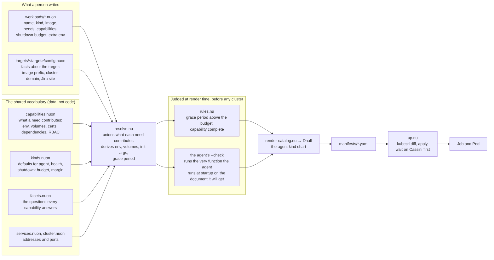
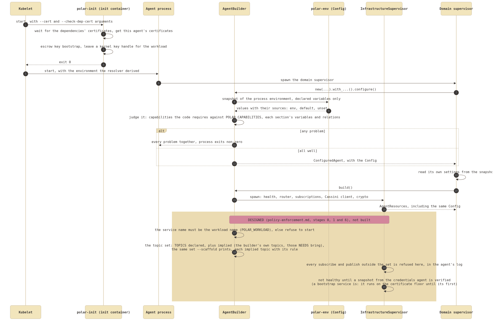

# How configuration flows from nuon to a running agent

Written 2026-10-09 from what exists, with real output. The design behind it is in
`configuration.md` (the declaration layer, `polar-env`) and `config-catalog-design.md` (the catalog);
the operator's recipes are in `infra/INFRA.md`. This document is the one place that follows a value
the whole way, so start here and go to those for the reasons.

Terms used throughout:

- **Capability**: a named need an agent has of its deployment (`cassini`, `graph-write`,
  `encryption`, `kube-api-read`). The catalog says what each one contributes (environment variables,
  volumes, certificates to get, services to wait for, cluster roles); the code says which ones it
  requires. They must agree, and today they are written twice (see "What is missing").
- **Section**: a group of variables a component declares in Rust with `polar-env`: the health
  actor's, the Cassini client's, the graph's, the crypto actor's, the builder's own. A capability
  brings the sections of the components it uses.
- **Snapshot**: the one reading of the process environment the builder takes at startup, holding
  only declared variables, each with where its value came from (`env`, `default`, `unset`).

## 1. From a person to a Pod



A workload is a few lines of nuon in `infra/config/workloads/`: its name, its kind (`agent`), its
image, what it `needs`, its shutdown budget, and any variables the catalog cannot derive. Facts about
the target (image registry, cluster domain, the Jira site) are in `targets/<target>/config.nuon`.
What a need means is data in `capabilities.nuon`; the defaults of a kind are in `kinds.nuon`;
`facets.nuon` lists the questions every capability must answer, so adding a capability cannot
forget one.

`resolve.nu` unions what each need contributes and derives the rest (the termination grace period
is the budget plus a margin and cannot be set separately). Before anything is rendered it is
judged twice: `rules.nu` checks what only the deployment knows (the grace period against the
budget), and `polar-config-check` runs the very function the agent runs when it starts on the
environment the workload will be given, so a bad environment fails the render and not the rollout.
Dhall then renders the manifest from the `agent` kind chart and `up.nu` applies it (it compares
with `kubectl diff`, leaves unchanged healthy Jobs alone, and waits for Cassini before the
clients).

## 2. From a Pod to a configured agent



The init container (`polar-init`) gets the agent's certificates and, for agents that encrypt,
bootstraps the escrow key and leaves a handle to it for the workload. The agent's domain
supervisor then builds its infrastructure with `AgentBuilder`: `configure()` takes the snapshot
and judges it, reporting every problem at once and exiting non-zero if there are any, and
`build()` spawns the infrastructure supervisor (health, router, subscriptions, the Cassini client,
the crypto actor). The same `Config` is handed back in `AgentResources`, and the domain code reads
its settings from it with `config.read(&VAR)`; a variable nobody declared is refused.

## 3. A worked example: kube-consumer

The catalog entry (`infra/config/workloads/kube.nuon`):

```nuon
{
  name: "kube-consumer"
  kind: "agent"
  image: "kube-consumer"
  needs: ["graph-write", "encryption"]
  shutdown: { budget_secs: 45 }
}
```

`cassini` is not listed: every agent built here is a Cassini client, so the resolver adds it. What
the deployment gives it (`nu infra/resolve.nu explain kube-consumer`), the environment part, where
the bracket says which capability or kind put it there:

```text
  env:
    TLS_CA_CERT                   /etc/tls/certs/ca.pem   [cassini]
    TLS_CLIENT_CERT               /etc/tls/certs/cert.pem   [cassini]
    TLS_CLIENT_KEY                /etc/tls/certs/key.pem   [cassini]
    BROKER_ADDR                   cassini-ip-svc.polar.svc.cluster.local:8080   [cassini]
    CASSINI_SERVER_NAME           cassini-ip-svc.polar.svc.cluster.local   [cassini]
    GRAPH_ENDPOINT                bolt+s://polar-db-svc.polar-graph.svc.cluster.local:7687   [graph-write]
    GRAPH_DB                      neo4j   [graph-write]
    GRAPH_USER                    neo4j   [graph-write]
    GRAPH_PASSWORD                secret polar-graph-pw/secret   [graph-write]
    GRAPH_CLIENT_CERT             /etc/neo4j-client-tls/cert.pem   [graph-write]
    GRAPH_CLIENT_KEY              /etc/neo4j-client-tls/key.pem   [graph-write]
    GRAPH_CA_CERT                 /etc/neo4j-client-tls/ca.pem   [graph-write]
    POLAR_HEALTH_FILE             /var/run/polar-health/polar-health.json   [kind]
    POLAR_HEALTH_CERTS            /etc/tls/certs/cert.pem,/etc/neo4j-client-tls/cert.pem   [kind]
    POLAR_HEALTH_EXPIRY_SECS      60   [kind]
    POLAR_HEALTH_TICK_SECS        30   [kind]
    POLAR_HEALTH_REJUVENATION_SECS  300   [kind]
    POLAR_HEALTH_STALE_SECS       90   [kind]
    POLAR_SHUTDOWN_BUDGET_SECS    45   [kind]
    POLAR_HEALTH_DEP_ENDPOINTS    cassini-ip-svc.polar.svc.cluster.local:8080:300,polar-db-svc.polar-graph.svc.cluster.local:7687:300   [kind]
    POLAR_CAPABILITIES            cassini,graph-write,encryption   [kind]
```

What the code says that environment means (`polar-config-check --effective`, run with exactly
that environment): every variable of the sections that apply, with its value, where it came from
and whether a scheduled override may change it.

```text
builder
  POLAR_CAPABILITIES = cassini,graph-write,encryption  [env, static]
  POLAR_SHUTDOWN_BUDGET_SECS = 45  [env, static]
health
  POLAR_HEALTH_FILE = /var/run/polar-health/polar-health.json  [env, static]
  POLAR_HEALTH_CERTS = /etc/tls/certs/cert.pem,/etc/neo4j-client-tls/cert.pem  [env, static]
  POLAR_HEALTH_DEP_ENDPOINTS = cassini-ip-svc.polar.svc.cluster.local:8080:300,polar-db-svc.polar-graph.svc.cluster.local:7687:300  [env, static]
  POLAR_HEALTH_REJUVENATION_SECS = 300  [env, static]
  POLAR_HEALTH_EXPIRY_SECS = 60  [env, static]
  POLAR_HEALTH_TICK_SECS = 30  [env, static]
  POLAR_HEALTH_STALE_SECS = 90  [env, static]
  POLAR_HEALTH_GRAPH_DEADLINE_SECS = 120  [default, static]
  POLAR_HEALTH_CASSINI_DEADLINE_SECS = 120  [default, static]
cassini-client
  TLS_CLIENT_CERT = /etc/tls/certs/cert.pem  [env, static]
  TLS_CLIENT_KEY = /etc/tls/certs/key.pem  [env, static]
  TLS_CA_CERT = /etc/tls/certs/ca.pem  [env, static]
  BROKER_ADDR = cassini-ip-svc.polar.svc.cluster.local:8080  [env, static]
  CASSINI_SERVER_NAME = cassini-ip-svc.polar.svc.cluster.local  [env, static]
  CASSINI_QUEUE_PATH = (not set)  [unset, static]
graph
  GRAPH_DB = neo4j  [env, static]
  GRAPH_USER = neo4j  [env, static]
  GRAPH_PASSWORD = <hidden>  [env, static]
  GRAPH_ENDPOINT = bolt+s://polar-db-svc.polar-graph.svc.cluster.local:7687  [env, static]
  GRAPH_CLIENT_CERT = /etc/neo4j-client-tls/cert.pem  [env, static]
  GRAPH_CLIENT_KEY = /etc/neo4j-client-tls/key.pem  [env, static]
  GRAPH_CA_CERT = /etc/neo4j-client-tls/ca.pem  [env, static]
crypto
  KUBERNETES_SA_TOKEN = /var/run/secrets/kubernetes.io/serviceaccount/token  [default, static]
  POLAR_ESCROW_KEY_HANDLE = /etc/tls/certs/escrow-key-handle  [default, static]
```

Reading the two together shows what neither shows alone. Four variables are in the second and
not the first: `POLAR_HEALTH_GRAPH_DEADLINE_SECS` and `POLAR_HEALTH_CASSINI_DEADLINE_SECS` (120 s
each), `KUBERNETES_SA_TOKEN` and `POLAR_ESCROW_KEY_HANDLE`. They are the code's defaults, and the
manifest, and `explain`, do not mention them. So the pod runs with a 120 s Cassini deadline that
nothing at the deployment layer says. This is the gap between the two views, listed below.

## 4. What you can ask today

| To learn | Command | Answers from |
| --- | --- | --- |
| what the catalog gives a workload, and why | `nu infra/resolve.nu explain <workload>` | the catalog |
| whether the whole catalog is consistent | `nu infra/resolve.nu check` | the catalog and the checker |
| every variable the builder's sections declare | `polar-config-check --describe` (`--json` for tools) | the code, for all agents alike |
| what an environment resolves to | `polar-config-check --effective` with the environment set | the code |
| whether an environment would start an agent | `polar-config-check` | the code |

Run `polar-config-check` from `src/agents` (`cargo run -p polar-agent-builder --bin
polar-config-check -- --describe`).

### Try the agent interface

`polar-agent-builder` has a small agent that implements `PolarAgent`
(`examples/hello_agent.rs`). It answers the three flags the design in `configuration.md` section 9
describes, and it reads its configuration from a document:

```text
cargo build -p polar-agent-builder --example hello_agent
hello_agent --help                          # what it is, needs and reads
hello_agent --scaffold > config.json        # the document, every value empty
                                            # fill it in: the resolver will, by hand here
hello_agent --check --config config.json    # ok: the configuration is sound
hello_agent --scaffold --config config.json # filled, with source and resolved value of each
POLAR_CONFIG=config.json hello_agent        # runs on the document
```

No real agent uses it yet; `kube-consumer` is the first to move.

## 5. What is missing

Updated 2026-10-09 after the agent interface (`configuration.md` section 9) was built and the
builder agents moved onto it.

Closed for the agents on the builder:

- **An agent can be asked what it needs.** Each implements `PolarAgent`; `--help`, `--scaffold` and
  `--check` answer for it. All six agents on the builder do (kube-observer, kube-consumer,
  jira-observer, jira-processor, and the credentials agent's consumer and observer).
- **Agents' own variables are declared.** The Jira observer's six are a `polar-env` section, read
  from its configuration, and the `disallowed_methods` lint now covers the four catalog agents.
- **The code's requirements and the catalog's `needs` are not copies any more.** For the four
  catalog agents the entry says `config: "document"`; the capabilities and the least shutdown
  budget come from the binary's own scaffold.
- **The two views meet.** The resolver fills the agent's scaffold, so what the pod is given is the
  agent's own declarations with the deployment's values written into them, the defaults visible
  (`<agent> --scaffold --config FILE`).

Still open:

1. **The credentials agent's consumer and observer read their environment**, not a document, and
   about ten of the consumer's variables are read with `std::env` and are not declared. Their
   charts are hand-written.
2. **Most workloads are not in the catalog.** Only `kube-observer`, `kube-consumer`,
   `jira-observer` and `jira-processor` are. The rest are hand-written charts under
   `infra/layers/`: the credentials agent consumer and observer, the Cassini broker (not on
   `polar-env`, its budget and grace written by hand), `polar-init`, ace, cert-issuer, Neo4j,
   Postgres, Keycloak, Jaeger; and the agents not yet on the builder (gitlab, git, scheduler,
   openapi, build-processor, resolver) are in neither. Their numbers are tied to their code by
   convention or by the runtime check only.
3. **The scaffold comes from a `cargo run`** at render time. Running the built image, which is the
   exact artifact that deploys, is not done (`configuration.md` 9.7).
