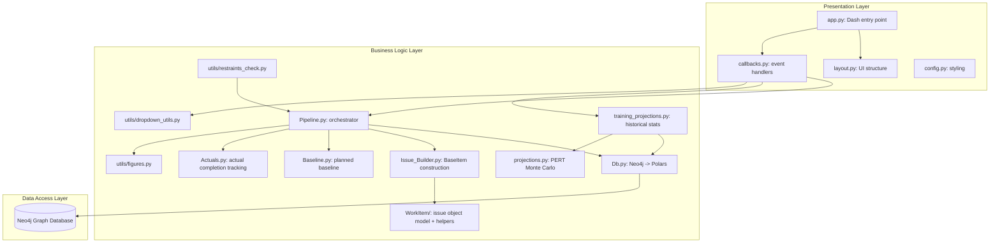
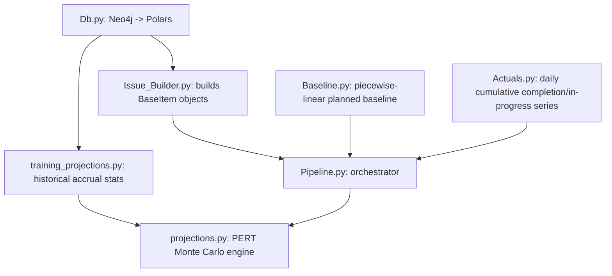
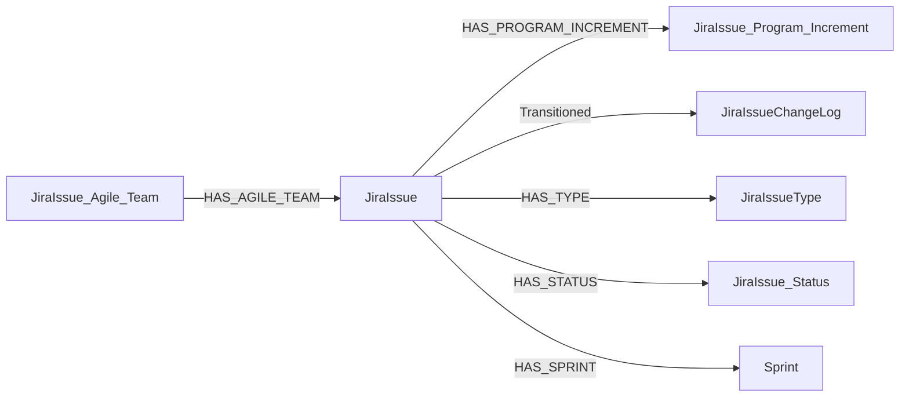
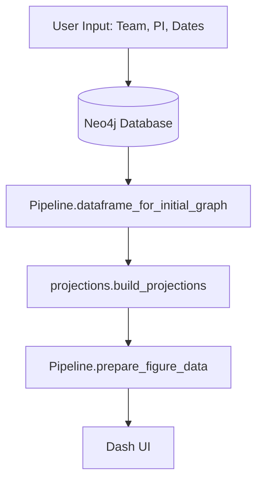

<!--
  ACE Tool

  Copyright 2026 Carnegie Mellon University.

  NO WARRANTY. THIS CARNEGIE MELLON UNIVERSITY AND SOFTWARE ENGINEERING INSTITUTE MATERIAL IS
  FURNISHED ON AN "AS-IS" BASIS. CARNEGIE MELLON UNIVERSITY MAKES NO WARRANTIES OF ANY KIND, EITHER
  EXPRESSED OR IMPLIED, AS TO ANY MATTER INCLUDING, BUT NOT LIMITED TO, WARRANTY OF FITNESS FOR
  PURPOSE OR MERCHANTABILITY, EXCLUSIVITY, OR RESULTS OBTAINED FROM USE OF THE MATERIAL. CARNEGIE
  MELLON UNIVERSITY DOES NOT MAKE ANY WARRANTY OF ANY KIND WITH RESPECT TO FREEDOM FROM PATENT,
  TRADEMARK, OR COPYRIGHT INFRINGEMENT.

  Licensed under a MIT (SEI)-style license, please see license.txt or contact permission@sei.cmu.edu
  for full terms.

  [DISTRIBUTION STATEMENT A] This material has been approved for public release and unlimited
  distribution.  Please see Copyright notice for non-US Government use and distribution.

  This Software includes and/or makes use of Third-Party Software each subject to its own license.

  DM26-0670
-->

# ARCHITECTURE.md

## Executive Summary

**ACE (Agile Capacity Estimator)** is a Python-based web dashboard that provides team completion-projection visualization for Agile/Scrum teams. It reads Jira-derived work-item data from a Neo4j graph database, runs a PERT-based Monte Carlo projection model against each team's actual historical performance, and visualizes projected completion timelines through interactive Plotly graphs with honest confidence bands.

ACE is a consumer of data, not a collector of it. It does not talk to Jira, GitLab, or any other source system directly — it reads only from Neo4j, which is populated by a separate ingestion system. This document describes ACE itself: its application structure, its data transformation and projection logic, and how it is built and run. It intentionally does not describe the system that populates the graph database; that integration is documented separately.

---

## 1. Overall System Design

### 1.1 High-Level Architecture



### 1.2 Technology Stack

| Layer | Technology | Purpose |
|-------|------------|---------|
| **Frontend** | Dash (Python) | Web framework for interactive UI |
| **Visualization** | Plotly | Interactive graph generation |
| **Data Processing** | Polars | High-performance DataFrame operations (not Pandas — do not introduce Pandas) |
| **Database** | Neo4j (>=5.28.2) | Graph database for work-item data |
| **Build** | Nix flake (`uv2nix` + `pyproject-nix`) | Reproducible Python environment and container image |
| **Container** | Nix `dockerTools.buildImage` | OCI-compatible application container |

---

## 2. Key Components and Responsibilities

### 2.1 `app.py` — Main Application Entry Point

**Responsibilities:**
- Initializes the Dash application instance with the Bootstrap theme
- Builds dropdown options for all UI controls at startup
- Creates the application layout
- Registers all interactive callbacks
- Starts the web server, reading `DASH_HOST`, `DASH_PORT`, and `DASH_DEBUG_MODE` from the environment

**Server startup (actual, current behavior):**
```python
host = os.getenv("DASH_HOST", "0.0.0.0")
port = int(os.getenv("DASH_PORT", "8080"))
debug = os.getenv("DASH_DEBUG_MODE", "False").lower() in ("1", "true", "yes")
app.run(host=host, port=port, debug=debug)
```
Debug mode is opt-in and defaults to off. It must not be enabled in any shipped deployment — Dash's debug mode exposes an interactive debugger and hot-reload endpoint that should never be reachable outside a developer's own machine.

### 2.2 `layout.py` — UI Layout Definition

Defines the complete UI structure using Dash HTML components, organized as a tabbed interface:

1. **Projection Chart** — team/PI selection, date pickers, advanced options, and the main PERT Monte Carlo projection graph
2. **Realtime Alerts** — WIP delay and completion-probability cards (the WIP Delay card's red-tinted styling is an intentional alert-state design choice, not debug scaffolding)
3. **Team Impact Adjustment** — side-by-side multi-team comparison

### 2.3 `callbacks.py` — Interactive Behavior

Implements all Dash callback handlers: dropdown population based on upstream selections (team → PI, PI → training PI), projection graph generation on demand, and advanced-options visibility toggling. Calls into `Pipeline.py` for the combined actuals/baseline DataFrame, `training_projections.py` for the PERT training distribution, and `projections.py` for the Monte Carlo run itself.

### 2.4 `config.py` — Application Styling

Defines the application's color palette (`app_color`), used consistently across `layout.py`, `callbacks.py`, and `utils/figures.py`. See §9 (Color Reference) for the full inventory.

---

## 3. Data Transformation Layer

### 3.1 `Pipeline.py` — Top-Level Orchestrator

The single entry point the rest of the app imports from. Wires together the modules below into the two DataFrames the dashboard needs: `dataframe_for_initial_graph()` (daily actuals + baseline, joined) and `prepare_figure_data()` (long-format data for Plotly).



### 3.2 `Db.py` — Neo4j Connection and Raw Queries

All Cypher queries and Neo4j connection handling live here. Nothing else in the data layer knows about Neo4j directly — every other module speaks Polars DataFrames only. Node labels, relationship types, and property names are read from environment variables (see §6.2) rather than hardcoded, so this module can target a differently-shaped graph without code changes.

**Current graph schema (defaults):**


### 3.3 `Issue_Builder.py` — BaseItem Construction

Converts the raw Neo4j DataFrame from `Db.py` into a list of `BaseItem` objects (one per issue key), handling datetime normalization, Fibonacci story-point rounding, sprint deduplication, and transition-timeline construction.

### 3.4 `Baseline.py` — Planned Baseline

Builds a piecewise-linear planned baseline (0% → 100%) across a PI. Automatically derives the active PI date window from the densest cluster of sprint end-dates (robust to carried-over cross-PI sprint references), filters sprints to the given team, and chains sprint-by-sprint linear ramps weighted by each sprint's assigned story points.

### 3.5 `Actuals.py` — Actual Completion Tracking

Builds the daily cumulative-completion and in-progress series from issue transition data, plus WIP-gap detection (flags dates where the in-progress/completed gap exceeds a threshold).

### 3.6 `projections.py` — PERT Monte Carlo Projection Engine

Branches from a user-supplied date using actual completed story points as the floor, then samples N velocity paths forward using a PERT distribution fit to historical training data. Supports two modes:

- **Issue-by-issue** (when `remaining_issues` is supplied): each outstanding issue gets its own sampled duration and completes individually as simulated working days elapse, with team-size contention modeled (a bounded team picks up the next-shortest remaining task). Produces both an aggregate projection band and a per-issue P10/P50/P90 completion-date summary.
- **Daily-velocity** (when `remaining_issues` is omitted): a SP/day rate is sampled and accumulated forward — no per-issue granularity.

### 3.7 `training_projections.py` — Historical Accrual Statistics

Fetches transition data across one or more historical PIs and computes per-issue accrual statistics (days per story point) that feed the PERT fit in `projections.py`. Supports recency-weighted percentiles so more recent PIs contribute more heavily than older ones.

### 3.8 `WorkItem/` — Issue Object Model

- `base_item.py` — the `BaseItem` class: scalar fields (key, type, team, weight, current state), per-state duration tracking, transitions, sprints.
- `helper.py` — `is_late_story()`, `get_work_hours()` / `get_work_hours_fast()` (working-hours calculation, Mon–Fri 8:00–17:00, US federal holiday aware, stdlib-only — no Pandas).
- `jira_map.py` — shared constants: `IN_PROGRESS_STATE`, `STATE_LIST`.

---

## 4. Data Flow



---

## 5. Build and Packaging

ACE is packaged as a reproducible Nix flake. The Python environment is built via `uv2nix`/`pyproject-nix`, reading dependency specifications from `flake_modules/pyproject.toml` and `flake_modules/uv.lock` — this is the single, canonical dependency manifest.

| Nix output | Purpose |
|------------|---------|
| `python-env.nix` | Builds the Python virtualenv (`mkVirtualEnv`) from the `uv2nix` workspace |
| `frontend.nix` | Packages the app + virtualenv into an OCI image via `dockerTools.buildImage` |

**Container image, as currently built:**
- Base: minimal (`coreutils`, `bash`, `tzdata` + the built Python virtualenv + app source)
- `WorkingDir`: `/app`
- `ExposedPorts`: `8080/tcp`
- `Entrypoint`: `/bin/run`, which execs `python /app/app.py`

```bash
nix build .#ace-viz-image
```

Neo4j is **not** built or bundled by this flake. It is treated as an external dependency, reachable via `NEO4J_URI`/`NEO4J_USER`/`NEO4J_PASSWORD` — the deployment target (Polar, once integrated) is expected to provide it.

---

## 6. Configuration

All configuration is delivered via environment variables. There is no `.env`-file loading anywhere in the application — this was removed as an anti-pattern incompatible with container/Kubernetes-native config delivery (Secrets/ConfigMaps inject environment variables directly; there is no file for the application to read).

### 6.1 Runtime Environment Variables

| Variable | Default | Purpose |
|----------|---------|---------|
| `NEO4J_URI` | *(required)* | Bolt connection string, e.g. `bolt://host:7687` |
| `NEO4J_USER` | *(required)* | Neo4j username |
| `NEO4J_PASSWORD` | *(required)* | Neo4j password |
| `DASH_HOST` | `0.0.0.0` | Interface the Dash server binds to |
| `DASH_PORT` | `8080` | Port the Dash server binds to (matches the container's `ExposedPorts`) |
| `DASH_DEBUG_MODE` | `False` | Enables Dash debug/hot-reload mode. Must remain `False`/unset in any shipped deployment. |

### 6.2 Schema Configuration

`schema_config.env` documents (as a reference template, not a loaded file) the environment variables `Db.py` reads to target the graph — node labels, relationship types, and property names. See the file itself for the full list and current defaults.

In deployment, these are delivered the same way as the runtime variables in §6.1 — via the orchestrator's Secret/ConfigMap mechanism, not a file.

---

## 7. Directory Structure

```
ace/
├── app.py                          # Dash application entry point
├── callbacks.py                    # Interactive callback handlers
├── config.py                       # Application styling
├── layout.py                       # UI layout definition
├── schema_config.env               # Neo4j schema configuration reference
├── flake.nix                       # Nix flake definition
├── flake.lock
├── .envrc                          # direnv: use flake .
├── .python-version
├── assets/
│   └── custom.css
├── data_transformation_directory/
│   ├── __init__.py
│   ├── constants.py                 # Shared constants (e.g. DONE_STATES)
│   ├── Db.py                        # Neo4j connection + raw Cypher queries
│   ├── Issue_Builder.py             # Raw DataFrame -> BaseItem objects
│   ├── Baseline.py                  # Planned baseline construction
│   ├── Actuals.py                   # Actual completion/in-progress tracking
│   ├── Pipeline.py                  # Top-level orchestrator
│   ├── projections.py               # PERT Monte Carlo projection engine
│   ├── training_projections.py      # Historical accrual statistics
│   └── WorkItem/
│       ├── __init__.py
│       ├── base_item.py             # BaseItem class
│       ├── helper.py                # is_late_story, get_work_hours(_fast)
│       └── jira_map.py              # IN_PROGRESS_STATE, STATE_LIST
├── utils/
│   ├── data_loader.py
│   ├── dropdown_utils.py            # Dropdown option assembly
│   ├── figures.py                   # Plotly figure builder
│   └── restraints_check.py          # Date range utilities
└── flake_modules/
    ├── python-env.nix               # Python environment (uv2nix)
    ├── frontend.nix                 # Container image definition
    ├── pyproject.toml               # Canonical dependency manifest
    └── uv.lock
```

---

## 8. Local Development

```bash
# Enter the reproducible dev shell (Nix + direnv)
direnv allow

# Set required env vars for a local Neo4j instance
export NEO4J_URI=bolt://localhost:7687
export NEO4J_USER=neo4j
export NEO4J_PASSWORD=<your_password>

# Run the app directly
python app.py
# -> http://localhost:8080
```

**Container build and run:**
```bash
nix build .#ace-viz-image
podman load -i result
podman run -p 8080:8080 \
  -e NEO4J_URI=bolt://<host>:7687 \
  -e NEO4J_USER=neo4j \
  -e NEO4J_PASSWORD=<password> \
  ace-viz:latest
```

Kubernetes/Polar-integrated deployment is out of scope for this document and will be covered in a follow-up pass once ACE is integrated into Polar's own infra targets.

---

## 9. Color Reference

Consolidated from a prior color-audit pass. `Suggested` is the canonical value each usage should converge on; several near-duplicate hex values were in use for what is conceptually the same color.

| Hex (in use) | Suggested (canonical) | Where used | Purpose |
|---|---|---|---|
| `#000000` | `#000000` | `callbacks.py` | Font/axis/annotation/title/hover-label color, border-bottom |
| `#1F2937` | `#1E293B` | `callbacks.py`, `assets/custom.css`, `layout.py` | Primary UI text (headers, labels, dropdown text, tab labels) |
| `#2E3440` | `#1E293B` | `assets/custom.css` | Dark text on light backgrounds (dropdown hover/focus) |
| `#2E3A46` | `#1E293B` | `config.py` | Theme text color (`APP_COLORS`) |
| `#3B82F6` | `#3B82F6` | `callbacks.py`, `assets/custom.css`, `config.py`, `layout.py`, `utils/figures.py` | Primary accent — buttons, active tab, Baseline series, slider handle, focus borders |
| `#4C5666` | `#475569` | `utils/figures.py` | `projection_median` series color |
| `#6B7280` | `#64748B` | `callbacks.py`, `layout.py` | Secondary/muted text |
| `#81A1C1` | `#81A1C1` | `assets/custom.css` | Subtle focus border (dropdowns/inputs) |
| `#b03e52` | `#E0445E` | `utils/figures.py` | `Actual` series color |
| `#D8DEE9` | `#CBD5E1` | `assets/custom.css` | Hover background (dropdowns/buttons) |
| `#E5E9F0` | `#E2E8F0` | `callbacks.py`, `assets/custom.css`, `layout.py`, `utils/figures.py` | Light background — cards, panels, dropdowns, chart fill |
| `#F5F7FA` | `#F8FAFC` | `config.py` | Page/app background (`APP_COLORS`) |
| `#FF0000` | `#FF0000` | `layout.py` | Intentional alert-state border/background (WIP Delay warning card, Realtime Alerts tab) |
| `#FFFFFF` | `#FFFFFF` | `layout.py` | White card/panel backgrounds |

---

## 10. Retired Code

The following were removed during a cleanup/consolidation pass and are noted here for anyone consulting old references or history:

- **`team_projections.py`** and **`projections_beta.py`** — an earlier, separately-maintained implementation of the projection engine. Superseded by `Pipeline.py`/`Db.py`/`Issue_Builder.py`/`Actuals.py`/`Baseline.py`/`projections.py`, which unify what were previously two separate Monte Carlo and Beta-distribution code paths into a single PERT-based engine.
- **A raw Jira-REST-API + Elasticsearch data path** (`get_jira_issue_from_data`, `get_all_issues_team_pi`, `get_in_progress_array`, `build_projection_map`, `get_issue_completion`, and related helpers in `WorkItem/helper.py`) — an earlier ingestion strategy that queried Elasticsearch directly for raw Jira JSON. Fully superseded by the Neo4j-native path in `Db.py`; confirmed unreferenced by the live application before removal.
- **Feature-level tracking** (`get_feature_data` in `Db.py`, `build_feature_actuals` in `Actuals.py`) — targeted a retired graph schema (`Team`/`WORKS_ON`/`Issue`/`Transition` rather than the current `JiraIssue_*` labels) and was not wired into `Pipeline.py`. Feature-level tracking is a real, wanted capability; this will need to be rebuilt against the current schema rather than resurrected as-is.
